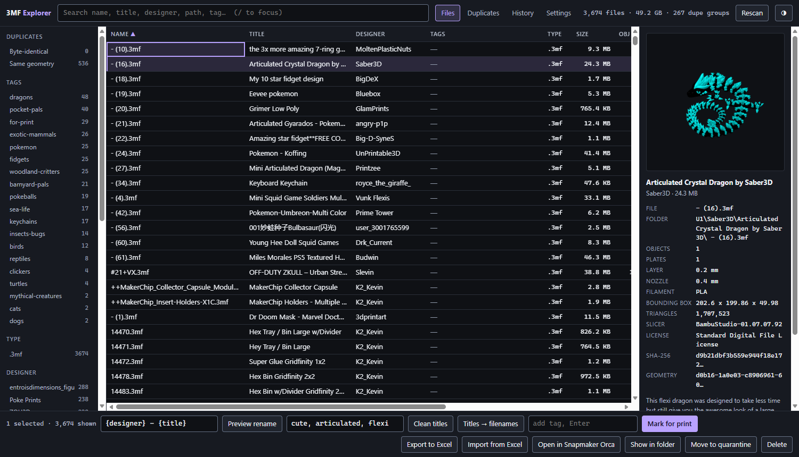

# 3MF Explorer

A fast, searchable index of your 3D model library. Point it at the folders
where you keep your `.3mf`, `.stl` and `.obj` files and it builds a table you
can search as you type - with plate thumbnails, designer and title pulled out
of the files themselves, duplicate detection, tags, batch renaming with undo,
and a round trip through Excel for bulk edits.

It runs on your own computer and opens in your browser. No account, no cloud,
nothing uploaded anywhere.

It ships alongside [U1 Print Hub](https://github.com/dlgambill/u1hub), a
Tier 3 award winner in Snapmaker's Innovation Fund (Phase 1, October 2026),
and works perfectly well on its own too.



## What it does

- **Indexes your library.** Every `.3mf`, `.stl` and `.obj` under the folders
  you choose. For 3MF files it reads what is embedded inside the file - title,
  designer, description, license, which slicer made it, layer height, nozzle,
  filament, object and plate counts, and the plate thumbnail. STL and OBJ
  files carry no metadata, so those rows are name, size and geometry only.
- **Finds duplicates two ways.** Byte-identical copies, and - the useful one -
  files with the same geometry even when the files differ (resliced, renamed,
  or exported by a different slicer).
- **Tags** you can add, search, rename and merge.
- **Batch renaming** from patterns like `{designer} - {title}`, with a preview
  first and a History tab that puts everything back.
- **Edits that stick.** Fix a title or designer in the table and it stays
  fixed through rescans, renames and moves.
- **Quarantine** for duplicates you want gone: they are moved to a folder you
  choose, not deleted, and the History tab can move them back.
- **Archive** for files you haven't printed in a year: once a month they move
  to an archive folder and drop out of the list, still one tick away in search.
- **Excel export and import.** Export the whole library, fix titles,
  designers and tags in a spreadsheet, import it back.
- **Open in your slicer** straight from the table.
- **Optional pairing with [U1 Print Hub](https://github.com/dlgambill/u1hub)**,
  so "Mark for print" sends files to the Hub.

## Download and run

Grab the file for your system from the
[U1 Print Hub Releases page](https://github.com/dlgambill/u1hub/releases/latest) -
3MF Explorer ships alongside the Hub there:

| System | File |
|---|---|
| Windows (64-bit) | `3MF-Explorer-Windows-x64.exe` |
| Mac with Apple Silicon (M1 and newer) | `3MF-Explorer-macOS-AppleSilicon` |
| Mac with Intel | `3MF-Explorer-macOS-Intel` |
| Linux (64-bit) | `3MF-Explorer-Linux-x64` |

Put it in a folder of its own and run it. Then open
<http://localhost:7333> in your browser.

The first time it runs, it creates `config.json` next to the program. Your
index (`library.db`) and thumbnails (`.thumb-cache`) are kept there too, so
the whole thing lives in that one folder. To move it, move the folder. To
start over, delete `library.db` and `.thumb-cache`.

A few first-run notes:

- Windows may warn about an unknown publisher. Click More info, then Run anyway.
- On a Mac, right-click the file and choose Open the first time. If macOS
  still refuses, open Terminal in that folder and run
  `xattr -d com.apple.quarantine 3MF-Explorer-macOS-*` and try again.
- On Linux (and from Terminal on a Mac), `chmod +x` the file, then run it.
- Only one copy can run on a port at a time. If it flashes and closes,
  something else already has port 7333 - change `port` in `config.json`.

### Running from source instead

You need Node.js 22.13 or newer (it uses Node's built-in SQLite).

```
npm install
npm start
```

In this case `config.json`, `library.db` and `.thumb-cache` live next to
`server.mjs`. On Windows you can also double-click `explorer.cmd`, which
starts the server and opens the browser for you.

## Setting it up

Open the **Settings** tab to pick your library folders, which file types to
show (3MF, STL, OBJ), the quarantine folder, and the archive folder with
how often and after how long the automatic archive runs. Type one folder
per line, tick the types you want, hit **Save and rescan**, and you're done -
no restart needed. Only files of those types inside those folders show up. If
you remove a folder or untick a type, those files drop out of the list
(nothing on disk is touched, and your titles, designers and tags come back
if you add them again). A rescan only starts when the folders or file types
changed; saving a new archive interval or quarantine folder is just a save.
A library folder that cannot be reached right now (say the NAS is off)
still saves, and the toast says so instead of refusing. The toast also says
when a protected entry was dropped because it repeated another one.

**Protected files** are for things that live in your library folders but
aren't models - a slicer template another app reads, a backup folder, your
scripts. Put a full folder path to protect everything in it, or a file name
(`*` works as a wildcard, like `template*.3mf`) to protect that name in any
folder. Protected files never show up in the list, so they can't turn up as
duplicates, and 3MF Explorer refuses to delete, move or rename them even if
something asks it to. Everything the app sends to the Recycle Bin or to
quarantine is written to `_actions-log.txt`, so you can always see what went
where.

Everything else lives in `config.json`, which Settings also writes to. Edit
it with any text editor, save, and restart 3MF Explorer. The file is checked
on startup: a value of the wrong type (for example `"port": "7333"` with
quotes) stops the start with a message naming the key and what it should be,
a key the app does not know is only a warning in the log, and a relative path
is taken as relative to the folder that holds `config.json`. A file saved
with a byte order mark (PowerShell's `Set-Content -Encoding UTF8` does that)
is read fine, with a warning.

```json
{
  "port": 7333,
  "roots": ["D:\\3D Models", "D:\\Downloads"],
  "fileTypes": [".3mf", ".stl", ".obj"],
  "protected": ["D:\\3D Models\\_templates", "template*.3mf"],
  "quarantine": "D:\\3D Models\\_quarantine",
  "backupDir": "",
  "concurrency": 0,
  "geometryMaxMB": 0,
  "openWith": [ ... ],
  "hub": { "url": "http://127.0.0.1:4545", "token": "" }
}
```

- **`roots`** - the folders to index (the Settings tab edits this). Everything
  under them is included, and nothing outside them is. On Windows, write
  backslashes twice (`D:\\Models`) or use forward slashes (`D:/Models`).
  After a hand edit, restart and hit **Rescan**.
- **`fileTypes`** - which of `.3mf`, `.stl` and `.obj` to index (the Settings
  tab edits this too). Leave it out to get all three.
- **`protected`** - files 3MF Explorer must never list, delete, move or
  rename. Full folder paths or file names (with `*` wildcards). Settings
  edits this too.
- **`quarantine`** - where "Move to quarantine" puts files. Leave it empty to
  use a `_quarantine` folder next to the program. On the same drive as your
  library a move is a plain rename; on another drive the file is copied,
  checked against the original (size and SHA-256), and only then removed
  from the library, so a failed copy never costs you the file. Folders named
  `_quarantine` are never indexed.
- **`backupDir`** - where the nightly backups go (see
  [Health check and backups](#health-check-and-backups)). Leave it empty for
  a `backups` folder next to `library.db`.
- **`concurrency`** - how many files to process at once during a scan. `0`
  picks a sensible number for your computer.
- **`geometryMaxMB`** - skip the geometry pass on files bigger than this many
  megabytes. `0` means no limit. Big files still get full metadata and
  byte-level duplicate checks.
- **`port`** - the port the page is served on.

Keep `library.db` on a local drive. Your model folders can be on a network
drive, but SQLite's database file should not be.

### Open in slicer

`openWith` is the list behind the "Open in ..." button. Each entry is a name
and the full path to the slicer's program:

```json
"openWith": [
  { "name": "OrcaSlicer", "exe": "C:\\Program Files\\OrcaSlicer\\orca-slicer.exe", "default": true },
  { "name": "PrusaSlicer", "exe": "C:\\Program Files\\Prusa3D\\PrusaSlicer\\prusa-slicer.exe" }
]
```

The starter config lists Snapmaker Orca, OrcaSlicer, Bambu Studio and
PrusaSlicer at their usual Windows install locations. Slicers that aren't
installed are simply skipped. The button uses the one marked `"default": true`
if it is installed, otherwise the first one it finds. Only programs listed
here can be launched - the page can never ask it to run anything else.

On a Mac, point `exe` at the program inside the app bundle, for example
`/Applications/OrcaSlicer.app/Contents/MacOS/OrcaSlicer`.

## Using it

### Searching

The search box filters as you type across name, title, designer, description,
path and tags. Words are ANDed together.

```
dragon flexi            both words, anywhere
designer:someone        one field only
ext:3mf dragon          combine them
-keychain               exclude
dupe:geometry           only same-geometry duplicates
tag:printed             only things you tagged
"baby dragon"           exact phrase
```

Press `/` to jump to the search box, `Esc` to clear, `Ctrl+A` to select
everything currently shown. Click column headers to sort. Double-click a
Title, Designer or Tags cell to edit it (with several rows selected, the
edit applies to all of them). Double-click anywhere else on a row to open
the file in your slicer.

### Duplicates

**Byte-identical** is the same file twice - the obvious case.

**Same geometry** means the mesh is identical but the file is not. That is the
same model resliced at a different layer height, or renamed, or exported by a
different slicer. Byte hashing misses all of those. 3MF Explorer hashes the
actual vertex set, independent of ordering, so it catches them.

Selecting duplicates never deletes anything. "Move to quarantine" relocates
them so you can look before you commit, and every quarantine is a batch in
the History tab: undo moves the files back into the library and starts a
rescan that lists them again, tags and titles included.

### Batch renaming

Select rows, type a pattern in the footer, hit **Preview rename**. You get a
before-and-after list and nothing happens until you hit Apply. Every batch is
recorded, and the History tab will put it all back.

| Token | Gives you |
|---|---|
| `{title}` | embedded title, or the filename if the file has none |
| `{designer}` | embedded designer, or `Unknown` |
| `{name}` | current filename without extension |
| `{folder}` | parent folder name |
| `{layer}` `{nozzle}` | `0.2mm`, `0.4mm` |
| `{objects}` `{plates}` | counts |
| `{app}` | slicer that made it |
| `{date}` `{year}` | creation date |
| `{mb}` | file size |
| `{sha8}` `{geom8}` | short hashes, handy for forcing uniqueness |
| `{n}` `{nn}` `{nnn}` | sequence number, zero-padded |

So `{designer} - {title} ({nn})` gives something like
`SomeDesigner - Sunflower Dragon (05).3mf`.

Extensions are kept automatically. If two files would end up with the same
name, the second gets ` (2)`, and the preview marks it so you can see it
happened.

**Clean titles** strips the designer's name, the words you list next to the
button, and a trailing catalog number from the Title field (not the file).
**Titles -> filenames** then renames files to match their titles. Both show a
preview first and both can be undone.

### Tags

Select rows, type in the tag box, press Enter. Tags show up in the filter rail
and are searchable with `tag:whatever`. Click a tag in the detail panel to
remove it. Tags are tied to the file's contents, so renaming or moving a file
keeps them.

### Excel export and import

**Export to Excel** saves the whole library as a spreadsheet. Edit the Title,
Designer and Tags columns, or set the Delete column to `TRUE` for files you
want gone, then **Import from Excel**. Rows are matched by ID, and everything
else in the sheet is there for reference only. Deleted files go to the
Recycle Bin (or to quarantine on a network drive, see below), never a hard
delete.

### Archive

Files you haven't printed in a long while can move out of the way without
leaving the library. Archived files sit in an archive folder inside your
library (by default `_archive` in the first library folder, keeping their
folder structure), stay indexed with their tags, titles and designers, and
are hidden from the list. Tick **Include archive** next to the search box to
see and search them too; they show an `archived` label.

- **By hand:** right-click a file (or a selection) and choose **Archive**.
  Right-click an archived file and choose **Restore from archive** to put it
  back where it came from.
- **Every 30 days, automatically (off until you turn it on):** files that
  have gone a year without printing are archived. Turn it on in Settings, then
  check the "N files qualify" line and run it once with **Archive them now**;
  automatic runs start only after that first run by hand. A file qualifies
  only when all of these are true:
  this app has known about it for at least that long, no print of it is
  recorded by U1 Print Hub in that time (see below), and it hasn't been opened
  in a slicer or marked for print from here in that time. Protected files and
  files tagged `for-print` are never archived. Restoring a file, or undoing an
  archive run, starts its year over.

Every archive run, by hand or automatic, is a batch in the **History** tab,
so one click undoes it. Moves are renames on the same drive: nothing is
copied and nothing is deleted. Settings has the archive folder, the on/off
switch, how often the automatic run looks (every 30 days unless you change
it), how many days count as "not printed", and a line saying when the next
run is and how many files would go right now.

Print history comes from U1 Print Hub's `printlog.json`, joined to the 3MF a
gcode was sliced from through the Hub's `models-links.json`. Set `hub.dir` in
`config.json` to the Hub's folder to use it. Files are matched by full path
(the Hub's models folder plus the link), so a mapped drive and the network
share behind it count as the same folder. Settings shows how many of the
Hub's printed files match a file here; 0 means the two apps are looking at
different folders. Prints of a gcode the Hub never linked to a 3MF can't be
seen, so they don't count. Without the Hub, only opens and print requests
from this app count.

## Pairing with U1 Print Hub (optional)

If you also run [U1 Print Hub](https://github.com/dlgambill/u1hub) on the same
computer, the **Mark for print** button can send files to the Hub's Models tab
as print requests.

1. In the Hub's own `config.json`, find `models.explorerToken`. The Hub
   creates it the first time it starts.
2. Paste that value into 3MF Explorer's `config.json` as `hub.token`. Leave
   `hub.url` as `http://127.0.0.1:4545` unless your Hub uses another port.
3. Restart 3MF Explorer.

Now select files and click **Mark for print**. Each one is tagged `for-print`
here (so you can always filter for them) and shows up as a request in the
Hub's Models tab. The files need to be inside the folder the Hub's Models tab
reads. If the Hub is offline the tag is still added, and clicking again later
resends.

If you don't use the Hub, leave `token` empty and ignore the button.

## Health check and backups

`GET /healthz` (for example <http://localhost:7333/healthz>) answers
`{"ok":true,"version":"1.7.1","dbOk":true}` when the database answers, and
status 503 when it does not, so a service monitor can watch it.

Every night at 03:00 (and once at startup if there is no backup for today
yet) 3MF Explorer writes a copy of `library.db` as `library-YYYY-MM-DD.db`
and a copy of `config.json` as `config-YYYY-MM-DD.json` into a `backups`
folder next to `library.db`, and keeps the newest seven of each. The database
copy is a clean snapshot taken while the server runs, so it is always usable:
to restore, stop the service, replace `library.db` with the copy, and start it
again. Set `backupDir` in `config.json` to keep the copies somewhere else;
pick a local drive, not the library share, so a problem with the share cannot
take the index and its backup at once.

## Privacy and security

- 3MF Explorer only listens on `127.0.0.1`, so only the computer it runs on
  can open it.
- There are no accounts and no password. Anyone who can reach the page can
  rename, move and delete files in your library. If you ever expose it beyond
  your own computer (a reverse proxy, a tunnel), put a login in front of it
  first, for example Cloudflare Access or a proxy with authentication.
- Other web pages open in the same browser cannot send it requests: every
  change has to come from the app's own page.
- It never contacts the internet. The only outgoing call is to your U1 Print
  Hub, and only if you set `hub.token`.

## Limits and platform notes

- **The first scan takes a while.** It reads every byte of every file to hash
  it and parses every vertex to build the geometry signature. On a library of
  a hundred gigabytes or more, expect it to run for a good stretch. Every scan
  after that only looks at files that changed, so a rescan takes seconds.
- **Delete on a network drive goes to quarantine.** Windows has no Recycle
  Bin for a mapped drive or a network share, so deleting there would be
  permanent. Files on a network drive are moved to the quarantine folder
  instead, and the Delete confirmation says so before you click.
- **Delete (Recycle Bin) and Show in folder are Windows only.** They use the
  Windows Recycle Bin and File Explorer. Everything else - scanning, search,
  duplicates, tags, renaming, quarantine, Excel, Open in slicer - works on
  Mac and Linux too.
- **Long paths are handled on Windows.** Paths longer than 260 characters are
  read through the extended-path form, so deep download folders are not
  silently skipped.
- **Nothing is ever hard-deleted.** Renames, archive runs and quarantine
  moves are reversible from the History tab, and Delete uses the Recycle
  Bin, or quarantine on a network drive. No move ever replaces a file that
  is already at the destination.
- **Scan problems show on the page.** A file that could not be read or a
  folder that could not be opened during a scan is counted in the status line,
  with the first few reasons, instead of only in the console.

## Command-line helpers (running from source)

```
node scan-cli.mjs                 rebuild the index for every folder in config.json
node scan-cli.mjs "D:\Downloads"  just one folder
node status.mjs                   quick counts, no server needed
node selftest.mjs "D:\Models"     parser and rename-token sanity check
node verify.mjs "D:\Models"       streamed-parser vs whole-file check
```

Don't run a scan from the command line while the server is scanning too.

## Tests

`npm test` runs the suite (`node --test`). Route tests start the real server
against a throwaway folder; nothing touches your library. The same suite runs
on GitHub Actions for every push and pull request, on Windows and Ubuntu, and
a tag build (`v1.7.1`) fails unless the tag, `package.json` and the first
heading in `CHANGELOG.md` agree: `node scripts/check-version.mjs v1.7.1`
runs that check locally.

## Building the binaries

```
npm install
npm run build
```

This writes all four downloads to `dist/`. `npm run build -- win` (or
`mac-arm`, `mac-intel`, `linux`) builds just one. It bundles the code with
esbuild, then wraps it in a Node 24 runtime with
[@yao-pkg/pkg](https://github.com/yao-pkg/pkg). The first build downloads
the runtimes, so it needs internet access.

The Apple Silicon build has to be signed before it will run on a Mac. Built
on a Mac, that happens automatically. Built on Windows or Linux, sign it on a
Mac afterwards with `codesign --sign - 3MF-Explorer-macOS-AppleSilicon` (an
ad-hoc signature is enough).

## License

MIT - see [LICENSE](LICENSE).
